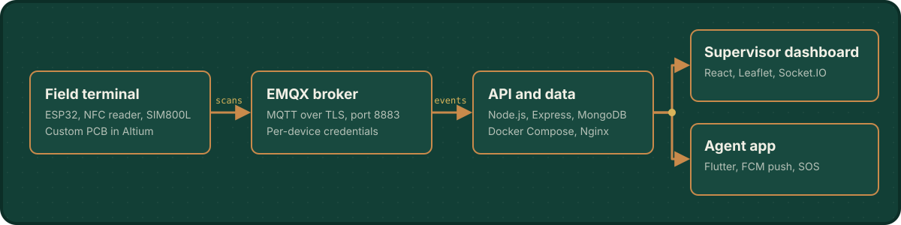

  

  
  

I build connected products from the copper up. At **RondeGuard** I own the whole chain: the ESP32 terminal and its PCB, the secure MQTT link, the Node.js backend, the supervisor dashboard and the agent app. I graduated from **ESPRIT** in 2026 with a National Engineering Degree in Ambient and Mobile Embedded Systems (SLEAM).

## What I'm building

### RondeGuard
Security patrol traceability: guards scan NFC checkpoints on their rounds, and supervisors follow every round live. It started as my end-of-studies project at Maker Skills and now runs in production.

  

Under the hood: TLS credentials stored in ESP32 NVS, GSM fallback through a SIM800L, man-down detection from an MPU6050, and an agent app that keeps working offline.

### FireTrack
A RondeGuard product for fire extinguisher management: inventory, NFC and barcode-verified inspections, due-date tracking, defect reports and a digital fire safety log. Built with MongoDB, Express, React and Node in TypeScript.

## Selected projects

| Project | What it does | Built with |
|:--|:--|:--|
| **SNCFT train tracking** Internship at SNCFT, 2025 | Real-time GPS localization of trains, from a custom antenna to the passenger app. Split across [app](https://github.com/bousnina-loujein/SNCFT-Tracker), [dashboard](https://github.com/bousnina-loujein/sncft-web-dashboard), [API](https://github.com/bousnina-loujein/sncft-backend-api), [firmware](https://github.com/bousnina-loujein/sncft-iot-testing), [PCB](https://github.com/bousnina-loujein/sncft-pcb-design), [antenna](https://github.com/bousnina-loujein/sncft_AntenneGps_CST) and [model](https://github.com/bousnina-loujein/sncft-smart-model). | ESP32, Node-RED, NestJS, Flutter, TensorFlow, CST |
| **[Smart Health Glove](https://github.com/bousnina-loujein/smart_health_glove_mobileApp)** ESPRIT, 2025 | A sensor glove for rehabilitation, with a custom antenna and an app that visualizes hand movement in real time. | C++, embedded sensors, mobile |
| **WaterSec** ESPRIT integrated project, 2025 | Leak and contamination detection for water networks. LSTM models reached 85% accuracy and cut water waste by about 30% in lab tests. | ESP32, GSM, custom PCB, LSTM, Flutter |

## Toolbox

  <b>Hardware and firmware</b> 
  
  
  
  
  
  

  <b>Connectivity</b> 
  
  
  
  

  <b>Backend, web and mobile</b> 
  
  
  
  
  
  
  

  <b>Deployment</b> 
  
  
  
  

## Activity

  
  

