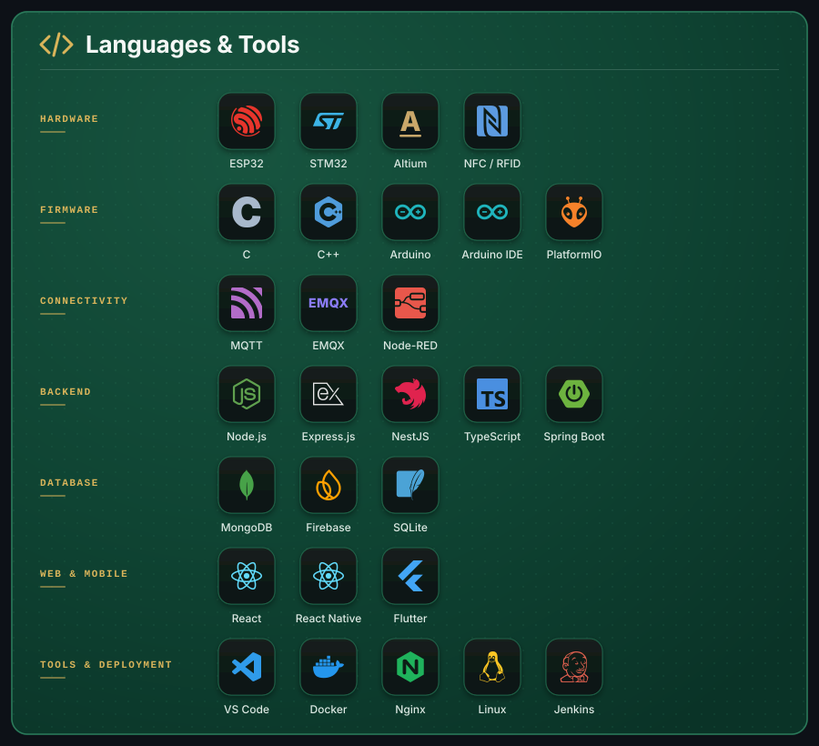

<b>PCB&nbsp;&nbsp;·&nbsp;&nbsp;FIRMWARE&nbsp;&nbsp;·&nbsp;&nbsp;CONNECTIVITY&nbsp;&nbsp;·&nbsp;&nbsp;CLOUD&nbsp;&nbsp;·&nbsp;&nbsp;WEB&nbsp;&nbsp;·&nbsp;&nbsp;MOBILE</b>

I'm an engineer graduated from **ESPRIT** with a National Engineering Degree in Ambient and Mobile Embedded Systems (SLEAM). Motivated and passionate about technology, embedded systems and innovation, I love turning ideas into connected products, from the PCB and firmware to the cloud and the apps people use every day.

 

